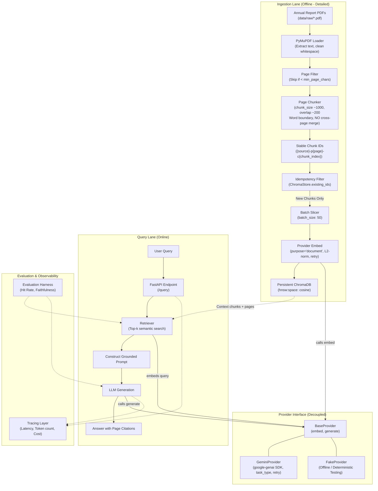

# Architecture

The system is organized into two primary execution pipelines—an offline **Ingestion Lane** and an online **Query Lane**—coordinated through a decoupled **Provider Interface**, alongside an **Evaluation Harness** and **Tracing** observability layer.

## Architecture Diagram

## Detailed System Explanation

### 1. Ingestion Lane (Phase 2)
The ingestion pipeline processes raw annual report documents into searchable vector representations:
1. **Document Loading (`ingestion/loader.py`)**: Uses PyMuPDF (`fitz`) to extract text page-by-page. Normalizes irregular whitespace into single spaces and strips margins. Inspects character counts per page, discarding blank or cover pages with fewer than `min_page_chars` (default 50) while issuing warnings if documents appear scanned/image-only.
2. **Page-Bounded Chunking (`ingestion/chunker.py`)**: Slices text into overlapping windows (default 1,000 characters, 200 overlap). Splits strictly at natural word boundaries to prevent amputating tokens. Crucially, chunking is confined to individual pages; text is **never merged across page boundaries**, preserving 100% accurate page citations.
3. **Stable Identifiers**: Assigns a deterministic identifier to every chunk using `{source}-p{page}-c{chunk_index}` (e.g. `infosys-ar-26-p42-c1`).
4. **Idempotent Store Check (`ingestion/indexer.py`)**: Before calling expensive embedding APIs, the indexer queries ChromaDB for existing chunk IDs. Existing chunks are skipped, ensuring zero duplicate vectors and zero redundant API costs when re-running.
5. **Batch Embedding (`providers/gemini.py`)**: New chunks are grouped into batches (default 50) and vectorized with `purpose="document"`, mapping to Gemini's `RETRIEVAL_DOCUMENT` task type. Vectors are L2-normalized to unit Euclidean length for accurate cosine distance comparison. Transient rate-limit (429) and server (5xx) errors trigger exponential backoff retry.
6. **Vector Storage (`retrieval/store.py`)**: Pre-computed vectors, chunk texts, and metadata (`source`, `page`, `chunk_index`) are inserted into persistent ChromaDB storage configured with cosine distance (`hnsw:space: cosine`). Application code outside `store.py` never imports ChromaDB directly.

### 2. Query Lane (Phase 3 & 4)
Incoming natural language queries hit the FastAPI application. The retriever vectorizes the query using `BaseProvider.embed(question, purpose="query")` (mapped to `RETRIEVAL_QUERY`). It retrieves top-$k$ nearest chunks from ChromaDB, constructs a context-grounded prompt, and invokes `BaseProvider.generate()`. The generated response includes exact page citations.

### 3. Provider Interface
Application layers depend entirely on the `BaseProvider` abstract base class. All provider-specific logic (SDK imports, task type mapping, output dimensionality, retries) is isolated inside `src/annual_report_rag/providers/`. Switching from live Gemini models to the offline `FakeProvider` requires only updating `config/settings.yaml`.

### 4. Evaluation & Tracing
An automated evaluation harness benchmarks retrieval hit rate and generation faithfulness against curated QA sets (`data/eval/`). Tracing tracks latency, token counts, and cost per query.
