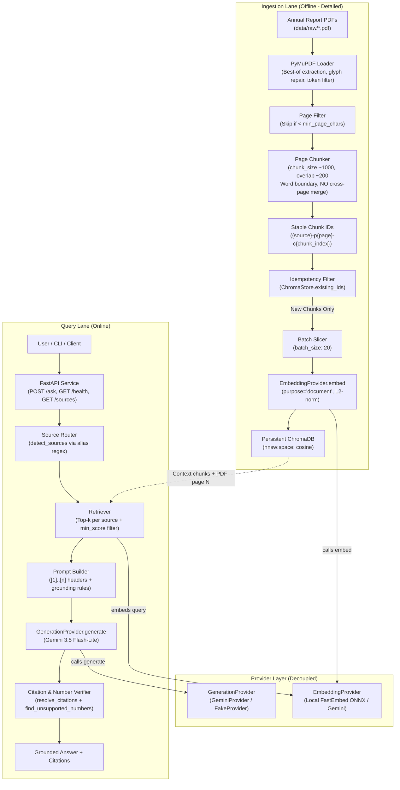
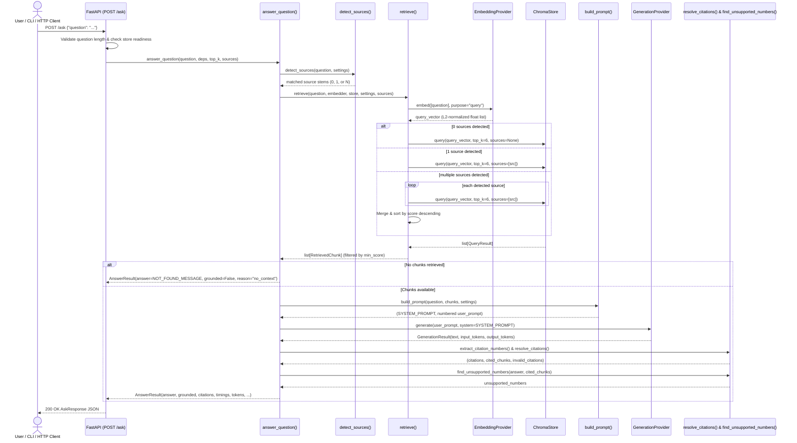

# Architecture

The system is organized into two primary execution pipelines—an offline **Ingestion Lane** and an online **Query Lane**—coordinated through decoupled **EmbeddingProvider** and **GenerationProvider** interfaces, alongside an **Evaluation Harness** and **Tracing** observability layer.

## Architecture Diagram (Overview)

## Query Lane Sequence Diagram (Phase 3)

## Detailed System Explanation

### 1. Ingestion Lane (Phase 2 – 2f.2)
The ingestion pipeline processes raw annual report documents into searchable vector representations:
1. **Document Loading & Quality Remediation (`ingestion/loader.py`, `ingestion/glyph_repair.py`)**: Uses PyMuPDF (`fitz`) to extract text page-by-page. Repairs confirmed Coptic/Greek/Cyrillic numeral and symbol font defects upfront (`glyph_repair.py`), selects between default extraction and `TEXT_INHIBIT_SPACES` on a per-page basis (`choose_better_extraction`), filters residual corrupted tokens (`\u0100`–`\u052F`) unless allowlisted (`keep_tokens`), and tags each page as `"clean"`, `"repaired"`, or `"degraded"`.
2. **Page-Bounded Chunking (`ingestion/chunker.py`)**: Slices text into overlapping windows (default 1,000 characters, 200 overlap) at natural word boundaries without ever merging across page boundaries, preserving exact `PDF page N` provenance.
3. **Stable Identifiers & Idempotent Indexing (`ingestion/indexer.py`)**: Assigns deterministic IDs (`{source}-p{page}-c{chunk_index}`) and skips chunks already present in ChromaDB.
4. **Vector Storage (`retrieval/store.py`)**: Stores L2-normalized 768-dim vectors (`BAAI/bge-base-en-v1.5` via local FastEmbed ONNX by default) in persistent ChromaDB configured with cosine distance (`hnsw:space: cosine`) and collection metadata validation.

### 2. Query Lane (Phase 3)
1. **Source Routing (`retrieval/router.py`)**: Inspects the user's question against configured company aliases (`"tcs"`, `"tata consultancy services"`, `"infosys"`) using case-insensitive whole-word regexes (`\b...\b`).
2. **Multi-Mode Retrieval (`retrieval/retriever.py`)**: Embeds the question with `purpose="query"`. Queries ChromaDB for a single company (`top_k=6`), per company merged by score (`top_k=6` per company for comparative questions), or globally across all reports (`top_k=6` when no company is mentioned).
3. **Grounded Prompting (`generation/prompts.py`)**: Formats retrieved passages as numbered `[1]..[n]` blocks labeled with the report's `display_name`, `PDF page N`, and `text quality`, paired with a 7-rule system instruction enforcing strict grounding, bracket citations, degraded-text caution, prompt-injection resistance, and a rupee-sign (`H` $\to$ `₹`) stopgap rule.
4. **Citation & Numeric Verification (`generation/answerer.py`, `generation/checks.py`)**: Parses `[n]` markers (`[1]`, `[1][2]`, `[1, 2]`), drops out-of-range references, sets `grounded=True` only when at least one valid citation exists and the answer is not `NOT_FOUND_MESSAGE`, and runs `find_unsupported_numbers()` to flag any numeric token in the answer whose normalized digits do not appear in the cited chunks.
5. **FastAPI Service (`api/main.py`)**: Initializes the store, embedder, and generator once in a `lifespan` context manager, and exposes synchronous `def` endpoints (`GET /health`, `GET /sources`, `POST /ask`) so FastAPI runs blocking ONNX/SDK calls in its worker threadpool without blocking the asyncio event loop.
