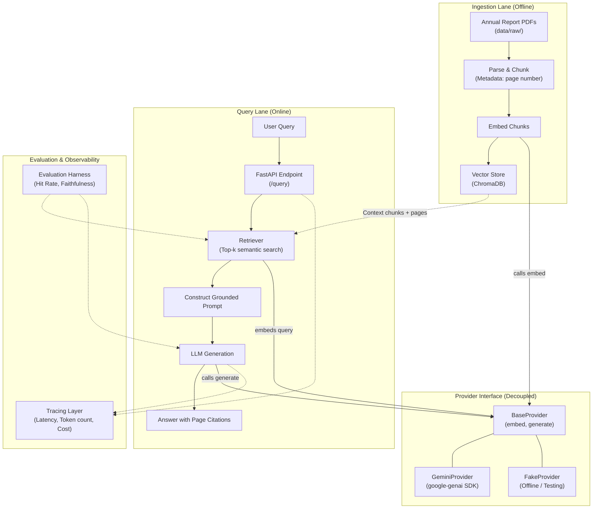

# Architecture

The system is organized into two primary execution pipelines—an offline **Ingestion Lane** and an online **Query Lane**—coordinated through a decoupled **Provider Interface**, alongside an **Evaluation Harness** and **Tracing** observability layer.

## Architecture Diagram

## System Explanation

1. **Ingestion Lane**: Raw annual report documents (PDFs) are parsed into text chunks, retaining provenance metadata (source document name and page number). The text chunks are vectorized via `BaseProvider.embed()` and indexed into the ChromaDB vector store.
2. **Query Lane**: Incoming questions hit the FastAPI application. The retriever embeds the user query via `BaseProvider.embed()` and retrieves the top-\$k\$ most relevant chunks from the vector store. A prompt is compiled from the retrieved passages, instructing the LLM to answer using only the provided facts. The LLM generates the final answer with explicit page citations.
3. **Provider Interface**: Application components never import concrete provider SDKs (such as `google-genai`) directly. Instead, they interact solely with `BaseProvider`. A factory instantiates the configured provider at runtime.
4. **Evaluation & Tracing**: The evaluation harness benchmarks retrieval hit rate and generation faithfulness against a curated evaluation dataset. Tracing monitors end-to-end latency and estimated token costs per query.
